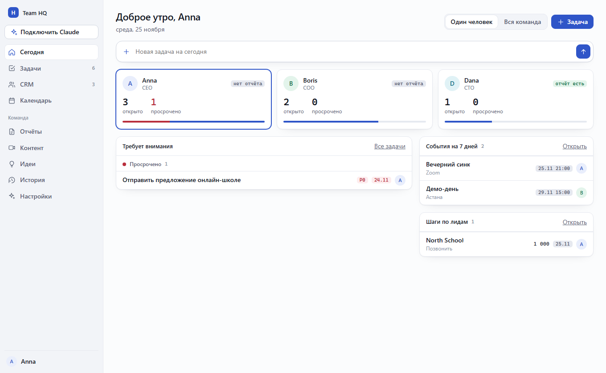

# Team HQ

**English** · [Русский](README.ru.md)

A small self-hosted workspace for a startup team: **tasks, CRM, calendar, daily reports, content and ideas**. Every teammate connects their own **Claude** through MCP and updates the board in plain language.



## Features

- **My day**: overdue and today's tasks, blockers, lead follow-ups, events, who has not reported yet
- **Boards and lists** by status with one-click moves, owner filter and search
- **Team overview**: open and overdue work per person and who has sent today's report
- **MCP server** (Streamable HTTP): `my_day`, `list_items`, `add_item`, `update_item`, `submit_report`, `who_is_who`
- **Phone**: responsive interface that can be added to the home screen
- **Telegram** notifications: new assignment, blocker, morning digest, evening report reminder
- **Calendar feed** (`.ics`) for Google or Apple Calendar
- **History** of changes; records are archived, never deleted
- **English and Russian** interface with a switch; `HQ_LANG=en` or `ru` sets the language of Telegram messages and MCP texts. Statuses are stored once, in Russian, and translated on screen
- **CSV and JSON import**

## Quick start

Node.js 24 or newer. No dependencies to install.

```bash
npm run demo               # invented demo data, prints sign-in links
npm start -- data/demo.db  # http://localhost:8787
```

Your own workspace:

```bash
npm run user -- --login anna --name "Anna" --role CEO
npm start
```

## Connect Claude

Open **Settings** in the app and copy your personal connector address.

- Claude (web, desktop, mobile): add it as a custom connector. This needs the app to be [deployed](docs/DEPLOY.md), because Claude cannot reach `localhost` from the cloud.
- Claude Code: `claude mcp add --transport http team-hq <address>` works with a local server too.

Then ask: *“What is on my plate today?”* or *“Mark the payment task as blocked: the bank has not replied.”*

## How it is built

```
public/      web interface, plain JavaScript
src/         request handling on web-standard Request and Response
  schema.js  one description of every table: database, validation, API, MCP and forms come from it
server/      Node.js server and a D1-compatible adapter over node:sqlite
scripts/     users, import, export
```

The same `src/` code runs on Node.js (SQLite) and on Cloudflare Workers (D1).

## Security

- Personal random keys; only SHA-256 hashes are stored
- Connector and calendar links use separate derived keys
- Parameterised SQL, strict input validation, Content Security Policy, no `innerHTML`
- Claude cannot delete or archive records
- A connector link gives full read and write access to its holder: treat it like a password
- Every member has the same rights; there are no roles yet

## Tests

```bash
npm test
```

## Contributing

Ideas for a first pull request: roles and permissions, comments on tasks, a monthly calendar grid, more interface languages.
