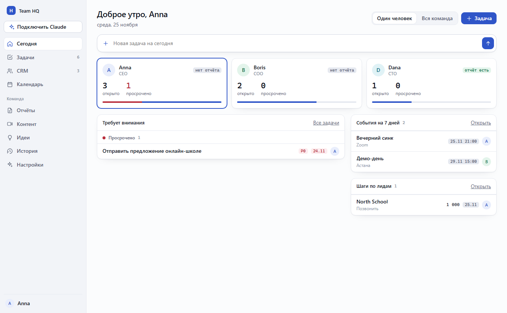

# Team HQ

[English](README.md) · **Русский**

Небольшое рабочее пространство для команды стартапа на своём сервере: **задачи, CRM, календарь, отчёты дня,
контент и идеи**. Каждый участник подключает свой **Claude** по MCP и обновляет доску обычными словами.



## Что умеет

- **Мой день**: просроченные и сегодняшние задачи, блокеры, шаги по лидам, события, кто ещё не сдал отчёт
- **Доски и списки** по статусам: смена в один клик, фильтр по ответственному и поиск
- **Обзор команды**: открытые и просроченные дела каждого и кто сдал отчёт
- **Сервер MCP** (Streamable HTTP): `my_day`, `list_items`, `add_item`, `update_item`, `submit_report`, `who_is_who`
- **Телефон**: интерфейс под узкий экран, значок на главном экране
- Уведомления в **Telegram**: новая задача, блокер, утренняя сводка, вечернее напоминание об отчёте
- **Календарь** (`.ics`) для Google или Apple Calendar
- **История** изменений; записи уходят в архив, а не удаляются
- **Импорт** из CSV и JSON
- **Русский и английский** интерфейс с переключателем; `HQ_LANG=ru` или `en` задаёт язык сообщений Telegram и
  текстов MCP. Статусы хранятся один раз, по-русски, и переводятся на экране

## Быстрый старт

Node.js 24 или новее. Зависимости не нужны.

```bash
npm run demo               # выдуманные данные, печатает ссылки для входа
npm start -- data/demo.db  # http://localhost:8787
```

Своё пространство:

```bash
npm run user -- --login anna --name "Anna" --role CEO
npm start
```

## Подключить Claude

Откройте **Настройки** в приложении и скопируйте личный адрес коннектора.

- Claude (сайт, приложение, телефон): добавьте как custom connector. Нужно, чтобы приложение было
  [опубликовано](docs/DEPLOY.ru.md): из облака Claude не достаёт до `localhost`.
- Claude Code: `claude mcp add --transport http team-hq <адрес>` работает и с локальным сервером.

Потом спросите: *«что у меня сегодня?»* или *«отметь задачу про оплату заблокированной: банк не ответил»*.

## Устройство

```
public/      веб-интерфейс на обычном JavaScript, i18n.js — оба языка
src/         обработка запросов на стандартных Request и Response
  schema.js  одно описание всех таблиц: база, проверки, API, MCP и формы строятся из него
server/      сервер Node.js и адаптер базы поверх node:sqlite
scripts/     пользователи, импорт, выгрузка
```

Один и тот же код `src/` работает на Node.js (SQLite) и на Cloudflare Workers (D1).

## Безопасность

- Личные случайные ключи; хранятся только их SHA-256 отпечатки
- Ссылки коннектора и календаря используют отдельные производные ключи
- Параметризованный SQL, строгая проверка ввода, Content Security Policy, без `innerHTML`
- Claude не может удалять и архивировать записи
- Ссылка коннектора даёт полный доступ тому, у кого она есть: берегите как пароль
- У всех участников одинаковые права, ролей пока нет

## Тесты

```bash
npm test
```
